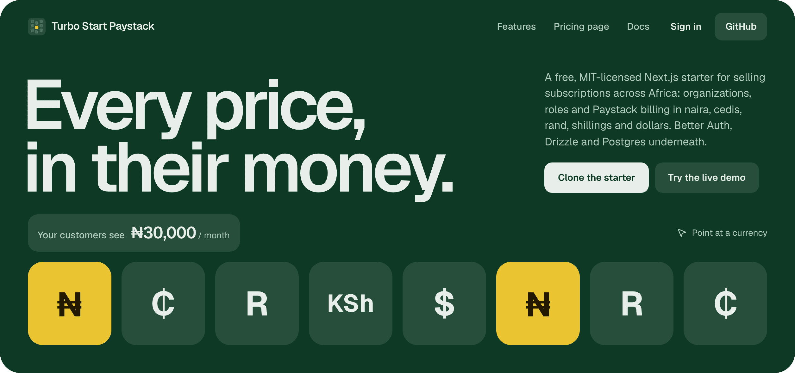
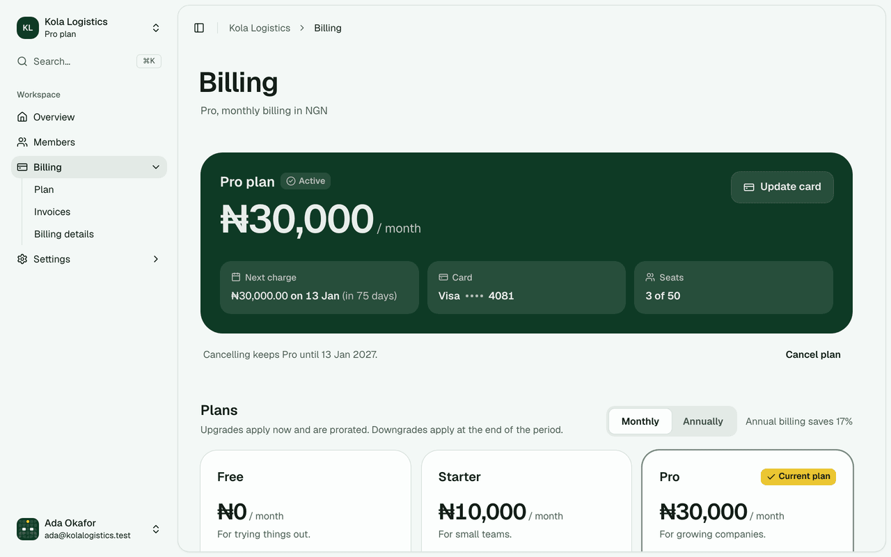
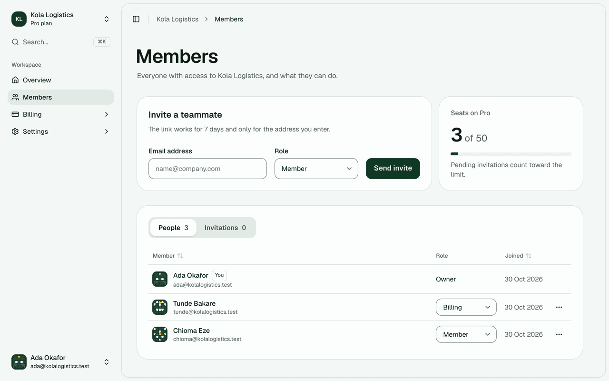
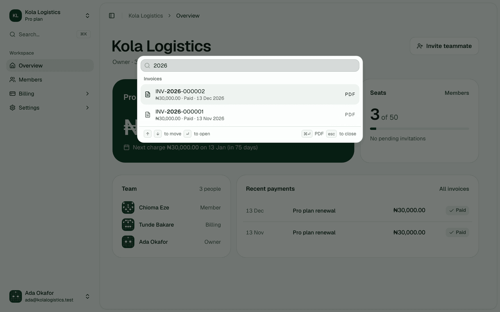
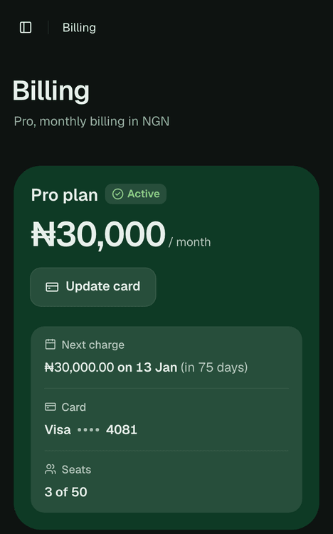
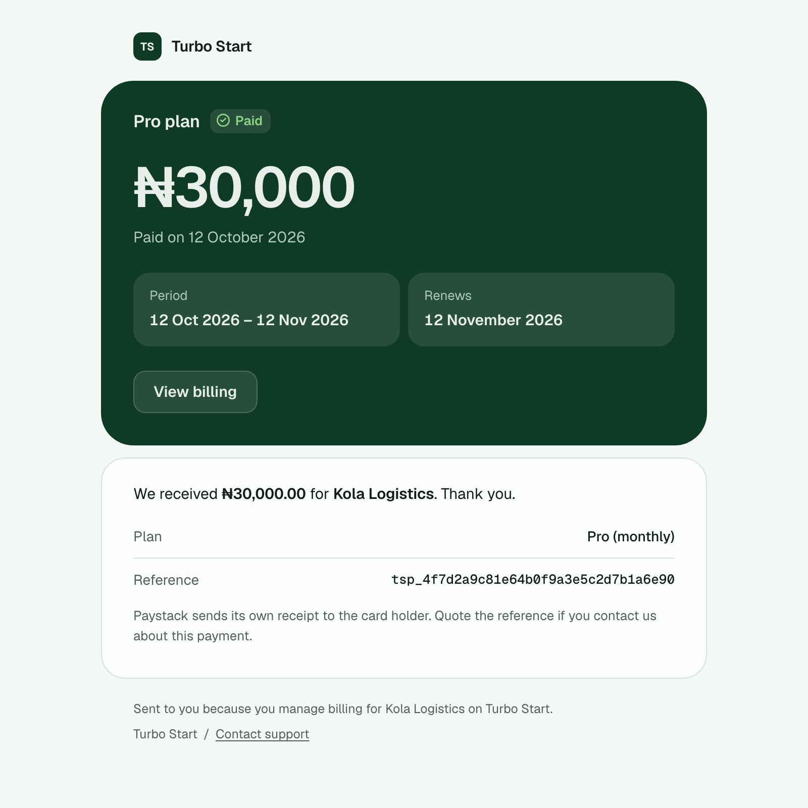
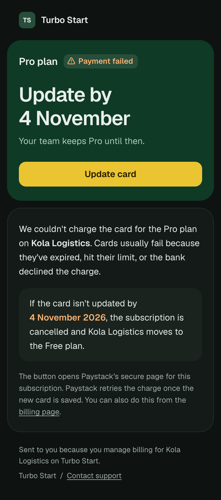

<picture>
  <source media="(prefers-color-scheme: dark)" srcset="docs/readme/hero-dark.png">
  
</picture>

# Turbo Start Paystack

[](https://github.com/akintola4/turbo-start-paystack/actions/workflows/ci.yml)
[](LICENSE)

Turbo Start Paystack is an open-source SaaS starter for teams that bill in
Africa. It is a `pnpm` monorepo with Turborepo, a Next.js 16 app, Better Auth
organizations and roles, and Paystack subscriptions.

**Live demo:** <https://turbo-start-paystack.vercel.app>. It runs in Paystack
test mode, so only Paystack's test cards work (for example
`4084 0840 8408 4081`) and no real money moves.

Billing state is written only by verified webhooks and server-side
verification. The browser never sends a plan status, an amount or a
subscription code.

## Use it with your AI agent

The repo is set up for coding agents (Claude Code, Codex, Cursor, Copilot,
Gemini CLI, Windsurf, Aider). [`AGENTS.md`](AGENTS.md) tells them how to set
it up, the billing rules they must not break and how to check their work.
Recipes for common jobs are in [`docs/agents/`](docs/agents/README.md).
Paste this into your agent:

```txt
Clone github.com/akintola4/turbo-start-paystack, read AGENTS.md, then set it up locally with the Paystack mock and add a "Team" plan at ₦20,000 a month with 25 seats.
```

It needs Node 24, pnpm and a Postgres it can reach (or Docker). No Paystack
keys are needed.

## What is included

- `apps/web`: Next.js 16 App Router app with sign-up and sign-in,
  organizations, members and invitations, a billing page, the Paystack webhook
  route, the checkout callback and the reconcile cron route
- `packages/billing`: typed Paystack client, plan catalog, checkout, webhook
  verification and idempotent processing, proration, plan changes,
  cancel/resume, dunning state and the reconcile job. Pure TypeScript with
  its database and HTTP dependencies passed in
- `packages/auth`: Better Auth with the organization plugin, org-scoped roles
  (owner, admin, billing, member, viewer) and `requirePermission`
- `packages/db`: Drizzle schema for auth and billing tables, migrations, and
  test databases (PGlite, or a real Postgres for concurrency tests)
- `packages/email`: React Email templates and the sender (Resend over
  HTTP, or a log in development)
- `packages/ui`, `packages/env`, `packages/logger`, `packages/tailwind-config`,
  `packages/typescript-config`: shared UI (shadcn, new-york), env validation
  (t3-env), a logger that redacts tokens, and config
- `scripts`: `pnpm setup` and `pnpm dev`, `billing:sync`, a local Paystack
  mock with a webhook simulator, and a webhook replay tool

<table>
  <tr>
    <td width="50%"></td>
    <td width="50%"></td>
  </tr>
  <tr>
    <td></td>
    <td align="center"></td>
  </tr>
</table>

## Repo layout

```txt
apps/
  web/            Next.js app (Playwright checks in apps/web/e2e)
packages/
  auth/           Better Auth config, roles, requirePermission
  billing/        Paystack billing domain (most of the tests live here)
  db/             Drizzle schema, migrations, test databases
  email/
  env/
  logger/
  tailwind-config/
  typescript-config/
  ui/
scripts/          setup, dev, billing:sync, paystack:mock, webhook:replay, fixtures/
docs/             decisions, Paystack setup, Paystack test-mode checklist
```

## Requirements

- Node.js 24 or newer
- pnpm 11 (`corepack enable` picks up the version in `package.json`)
- Postgres 15 or newer (Neon, Supabase, Railway or local)
- For `pnpm setup`, one of: Docker, a local Postgres install
  (`initdb`/`pg_ctl` on your `PATH`), or a Postgres that is already running
  (see [Postgres you already run](#postgres-you-already-run))
- A Paystack account for real payments. Not needed locally: `pnpm setup`
  uses a Paystack mock

## Getting started

No Paystack account needed: the local stack runs against a Paystack mock.

```bash
git clone https://github.com/akintola4/turbo-start-paystack.git
cd turbo-start-paystack
pnpm install
pnpm setup
pnpm dev
```

Open the URL `pnpm setup` prints (usually `http://localhost:3000`) and sign
in as `ada@kolalogistics.test` with the password `kola-demo-2026`. On
Billing, press "Start 14-day trial" on a plan, then "Pay with test card" on
the mock checkout. You land back on Billing with the plan in trial. Open the
**Simulate billing** card at the bottom of the page to end the trial and play
renewals, failed payments and recoveries. On a clean clone `pnpm setup` takes
about 15 seconds after `pnpm install`.

`pnpm setup` is safe to run again. It:

- checks Node 24+, pnpm, and Docker or a local Postgres (`initdb`/`pg_ctl`),
  and prints the fix for anything missing. If Docker is installed but its
  daemon doesn't answer within 8 seconds, it counts as not running;
- creates `apps/web/.env` from `.env.example`, generates
  `BETTER_AUTH_SECRET`, `BILLING_ENCRYPTION_KEY` and `CRON_SECRET`, and points
  Paystack at the local mock. It only fills blanks and the template's
  placeholders: a value you set is never changed, and secrets are never
  printed;
- picks free ports for the app (from 3000) and the mock (from 4010) and
  writes them into `BETTER_AUTH_URL`, `NEXT_PUBLIC_APP_URL`,
  `PAYSTACK_API_URL`, `PAYSTACK_MOCK_PORT` and `PAYSTACK_MOCK_WEBHOOK_URL`;
- uses `DATABASE_URL` from `apps/web/.env` if you set one. Otherwise it
  reuses a Postgres on 127.0.0.1:54329 that accepts the `postgres` user, or
  starts one with `scripts/dev-db.sh` (Docker if it is running, else a local
  server with its data in `.pgdata/`). Then it creates the database and runs
  the migrations;
- creates the plans on the mock (`billing:sync`) and seeds Kola Logistics:
  Ada (owner), Tunde (billing) and Chioma (member), all with verified email
  and the same demo password.

`pnpm dev` runs the app and the mock in one terminal with `app │` and
`mock │` log prefixes, and starts the dev Postgres again if it is down.
`pnpm dev:web` runs only the app.

```bash
pnpm setup:reset                  # drop and reseed the dev database (stop pnpm dev first)
SETUP_DB=my_db pnpm setup         # use another database name
SETUP_PORT=3600 pnpm setup        # fixed app port (SETUP_MOCK_PORT for the mock)
DATABASE_URL=postgres://…/<db> pnpm setup   # a local Postgres of your own, when apps/web/.env has none
CI=1 pnpm setup                   # never prompt (also the case without a terminal)
```

Without a terminal, setup never waits for input: it uses the defaults, or
stops with exit code 1 and the fix when something is missing.

pnpm has a built-in `setup` command. pnpm 10 and 11 run this repo's script
instead, but drop or reject flags after it (`pnpm setup --port=3600` fails
with "Unknown option"), which is why the variants above use environment
variables. Flags work through `pnpm run setup -- --yes --port=3600`.
On pnpm 9 or older, `pnpm setup` is pnpm's own command (it edits your shell
profile): use `corepack enable` to get the pnpm version in `package.json`.

macOS and Linux are supported. On Windows, use WSL 2 (`dev-db.sh` is a bash
script).

### Postgres you already run

`pnpm setup` doesn't look at port 5432. If you already run Postgres there
(Postgres.app, a Homebrew service, a system package), or Docker isn't an
option, point setup at it before the first run:

```bash
DATABASE_URL=postgres://<your-user>@127.0.0.1:5432/turbo_start_paystack pnpm setup
```

Setup creates the database if it is missing, writes the URL into
`apps/web/.env` and fills in everything else. A `DATABASE_URL` already in
`apps/web/.env` wins over the environment. From the environment, setup only
takes a URL on this machine that names a database, since it migrates and
seeds it: a `DATABASE_URL` exported for another project won't be touched.
Set `SETUP_ALLOW_REMOTE_DB=1` to use a remote one on purpose.

### Simulate billing (development only)

The billing page ends with a dashed **Simulate billing** card, shown to
owners and billing managers when the app runs against the local mock. It
starts collapsed; click its header to open it. Each button asks
the mock to emit what Paystack would send for the organization's
subscription, signed with the secret key, to the real
`/api/webhooks/paystack` route. The panel waits for the handlers to process
the events, then runs reconcile, as the hourly cron would. It never writes
billing state itself.

| Button | What the mock sends | Result |
|---|---|---|
| Fast-forward to renewal | `charge.success` + `invoice.update` for the next billing date | Period moves on, receipt email |
| Fail the next renewal | `invoice.payment_failed`; the mock's subscription goes to `attention` | Past due, grace banner, failed-payment email |
| Recover | The retried charge succeeds | Active again, the failed invoice is paid |
| End the trial | Reconcile's trial reminder (as of 2 days before the end), then the first charge | Trial-ending email, then active |
| Duplicate the last event | The same body and signature again | `ignored: duplicate` (stored once) |
| Forged webhook | A `charge.success` signed with the wrong key | `401 bad_signature`, nothing stored |
| Simulate a month | Renewal, failed renewal, recovery, one step at a time | Step log |

The event log shows each webhook's HTTP status and what its handler did. The
Emails tab lists the dev outbox (every email sent without
`RESEND_API_KEY`: verification, invitations, receipts) with a link to the
rendered HTML.

Guards: the panel renders, and `/api/dev/orgs/:orgId/*` answers, only when
`NODE_ENV` is not `production`, `PAYSTACK_API_URL` is plain `http` on
`localhost`, `127.0.0.1` or `[::1]`, and the secret key is not `sk_live_`.
Otherwise those routes return 404 (checked before the session). They also
require `billing:manage` on the organization in the URL, and take only an
action name: the subscription code comes from the database, never the
request. The mock's `/__dev/simulate` requires the secret key as a bearer
token.

<details>
<summary>Manual setup</summary>

#### 1. Install

```bash
pnpm install
```

#### 2. Configure environment variables

```bash
cp .env.example apps/web/.env
```

Fill in `apps/web/.env`. Every variable is listed in `.env.example`; the app
refuses to boot if a required one is missing or malformed.

| Variable | Required | What it is |
|---|---|---|
| `DATABASE_URL` | yes | Postgres connection string |
| `DATABASE_URL_UNPOOLED` | no | Direct (non-pooled) connection, used by `vercel-build` for migrations. Neon's Vercel integration sets it |
| `BETTER_AUTH_SECRET` | yes | 32+ random characters (`openssl rand -base64 32`) |
| `BETTER_AUTH_URL` | yes | Public URL of the app, e.g. `http://localhost:3000` |
| `NEXT_PUBLIC_APP_URL` | no | Same as above, for the browser. Defaults to localhost |
| `PAYSTACK_SECRET_KEY` | yes | `sk_test_…` or `sk_live_…`. Also the webhook signing key |
| `NEXT_PUBLIC_PAYSTACK_PUBLIC_KEY` | no | `pk_test_…`. Enables the inline popup; without it checkout redirects to Paystack |
| `PAYSTACK_API_URL` | no | Leave unset in production. Point at the local mock in development |
| `PAYSTACK_MOCK_PORT`, `PAYSTACK_MOCK_WEBHOOK_URL` | no | Local mock only: its port, and where it sends webhooks |
| `PAYSTACK_WEBHOOK_IP_ALLOWLIST` | no | `true` to also reject webhooks not from Paystack's IPs |
| `CLIENT_IP_HEADER` | no | Header your proxy writes the client IP into (right-most entry is used). Default `x-vercel-forwarded-for` on Vercel, else `x-forwarded-for` |
| `TRUSTED_PROXIES` | no | Comma-separated IPs or CIDRs of your own proxies, when the IP header holds a chain. Without them, every client shares one rate limit. Not needed on Vercel |
| `BILLING_ENCRYPTION_KEY` | yes | 64 hex chars (`openssl rand -hex 32`). Encrypts email tokens and card authorizations |
| `BILLING_CURRENCY` | no | `NGN` (default), `GHS`, `ZAR`, `KES` or `USD` |
| `BILLING_GRACE_DAYS` | no | Days a failed renewal keeps access. Default 7 |
| `BILLING_TRIAL_MODE` | no | `card` (default): card-up-front trials. `off`: no trials |
| `CRON_SECRET` | yes | 16+ chars. Bearer token for `/api/cron/billing-reconcile` |
| `EMAIL_FROM` | no | Sender, e.g. `Acme <billing@mail.acme.com>`. Its domain must be verified in Resend |
| `RESEND_API_KEY` | prod | Without it, emails are written to the server log (development only) |
| `EMAIL_TRANSPORT` | no | `log` lets a local `next start` log emails. Never set it on a real deployment |
| `EMAIL_BRAND_NAME` | no | Product name in email headers and footers. Default `Turbo Start` |
| `EMAIL_LOGO_URL` | no | https URL of a logo (shown 28px tall). Without it, the name is used as a wordmark |
| `EMAIL_SUPPORT_URL` | no | `https:` or `mailto:` link for "Contact support" in the footer |
| `INVOICE_SELLER_NAME` | no | Seller on invoices. Default: `EMAIL_BRAND_NAME` |
| `INVOICE_SELLER_ADDRESS` | no | Seller address; write line breaks as `\n` |
| `INVOICE_SELLER_EMAIL` | no | Seller contact email on invoices |
| `INVOICE_SELLER_TAX_ID` | no | Company or tax registration, e.g. `RC 1234567` or a TIN |
| `INVOICE_SELLER_VAT_NUMBER` | no | VAT registration number |
| `INVOICE_VAT_RATE` | no | VAT included in your prices, in percent (Nigeria: `7.5`). Unset or `0`: no VAT lines |

#### 3. Create the database

Use any Postgres. For a throwaway local one, `./scripts/dev-db.sh` starts
Postgres 17 (Docker, or a local install) and prints a `DATABASE_URL`.

```bash
DATABASE_URL=postgres://… pnpm db:migrate
```

#### 4. Create the Paystack plans

```bash
pnpm billing:sync                     # BILLING_CURRENCY only
pnpm billing:sync --currencies=NGN,USD
```

This creates one Paystack plan per plan, interval and currency in
`packages/billing/src/catalog.ts` and stores the plan codes. It is safe to run
again. It never changes the amount of an existing plan; to change a price, add
a new price to the catalog.

#### 5. Start the app

```bash
pnpm dev:web
```

Open `http://localhost:3000`, create an account, then an organization.

#### Developing without Paystack keys

`pnpm paystack:mock` runs a local stand-in for `api.paystack.co` on port 4010
with a fake hosted checkout page. Set `PAYSTACK_API_URL=http://localhost:4010`
and `PAYSTACK_SECRET_KEY=sk_test_local_mock`, run `pnpm billing:sync`, then
subscribe from the billing page. The mock's "Pay with test card" button
sends signed `charge.success` and `subscription.create` webhooks to the app,
like Paystack would. It is for development only and is not a Paystack
simulator.

</details>

## Useful commands

```bash
pnpm setup             # one-time (and re-runnable) local setup
pnpm dev               # app + Paystack mock
pnpm dev:web           # Next.js app only
pnpm email:preview     # React Email preview of every template on :3001
pnpm build             # build everything
pnpm lint              # Biome
pnpm format            # Biome format
pnpm check-types       # TypeScript
pnpm test              # Vitest in every package
pnpm e2e               # Playwright, against a fresh e2e database and the mock
pnpm db:generate       # new migration after a schema change
pnpm db:migrate        # apply migrations
pnpm billing:sync      # create Paystack plans from the catalog
pnpm paystack:mock     # local Paystack API + checkout page
pnpm webhook:replay scripts/fixtures/charge-success.json
```

## Tests

There are 532 tests across the packages. Most run against PGlite (Postgres
in-process) with the Paystack API replaced by an in-memory fake behind msw.
No keys or services are needed:

```bash
pnpm test
```

The 3 concurrency tests need a real Postgres server, because PGlite has a
single connection. They are skipped unless `TEST_DATABASE_URL` is set (CI
sets it):

```bash
TEST_DATABASE_URL=postgres://postgres@localhost:5432/postgres pnpm test
```

Webhook tests use payloads built from Paystack's documented examples
(`packages/billing/src/fixtures.ts`). Behaviour that still has to be confirmed
against real Paystack test mode is listed in `docs/paystack-verification.md`.

### Browser tests (Playwright)

Browser checks live in `apps/web/e2e`. They aren't part of `pnpm test`.
`pnpm e2e` runs them from a clean state, with no Paystack keys:

```bash
pnpm --filter web exec playwright install chromium  # once
pnpm e2e                                            # the whole suite
pnpm e2e e2e/settings.spec.ts --workers=1           # Playwright flags pass through
```

Each run:

1. drops and recreates the e2e database, migrates it, and seeds the demo
   organization plus a viewer (Wanjiru Kamau). The database is
   `DATABASE_URL` from `apps/web/.env` with `_e2e` added to its name, or
   `E2E_DATABASE_URL`. Since it is dropped, it must be on localhost and its
   name must end in `_e2e`;
2. starts the Paystack mock (port 4210, `E2E_MOCK_PORT`) with its own state
   file and creates the plans on it;
3. starts `next dev` on port 3200 (`E2E_PORT`) against the mock, runs
   Playwright, then stops both.

Whatever `apps/web/.env` says, the run points Paystack at the mock, drops
the public key (no inline popup) and `RESEND_API_KEY` (emails are only
logged), and bills in NGN. It also sets `E2E_AUTH_RATE_LIMIT_SCALE`, which
raises Better Auth's limits (five sign-ins a minute) only when `NODE_ENV`
isn't `production` and Paystack is the local mock.

Playwright's `setup` project runs first. It signs Ada, Tunde, Chioma and
Wanjiru in once and saves each session to `apps/web/e2e/.auth/` (specs reuse
them with `test.use({ storageState: STATE.ada })`). Then it puts Kola
Logistics on a paid Pro plan the way a person would: "Start 14-day trial"
on Pro, "Pay with test card" on the mock's checkout, then "End the trial" in
the Simulate billing panel, which leaves an invoice. No billing row is
written by hand. `settings.spec.ts` renames the org and moves its address
(and puts both back), so it runs last, on its own.

To iterate on one spec without restarting the app each time:

```bash
pnpm e2e --serve                                    # set up, start, wait
pnpm --filter web test:e2e e2e/toasts.spec.ts       # in another terminal
```

`--serve` resets the database once; the setup project skips what is already
done, so repeat runs against it work too.

## Paystack dashboard setup

1. Settings → API Keys & Webhooks: copy the test secret and public keys into
   `PAYSTACK_SECRET_KEY` and `NEXT_PUBLIC_PAYSTACK_PUBLIC_KEY`.
2. On the same page, set the webhook URL to
   `https://<your-domain>/api/webhooks/paystack` and the callback URL to
   `https://<your-domain>/billing/callback`. The app also sends the callback
   URL with each transaction, built from `BETTER_AUTH_URL`. Test and live
   mode have separate URLs; set both. For local development against real
   Paystack, use a tunnel (`cloudflared tunnel --url http://localhost:3000`
   or `ngrok http 3000`), paste its URL, and set `BETTER_AUTH_URL` to it.
3. Create the plans with `pnpm billing:sync`: once with the test key against
   your development database, once with the live key against production.
   Test and live plan codes differ. On Vercel the build does this for you
   (see [Deploying](#deploying)).
4. Schedule `GET /api/cron/billing-reconcile` hourly with
   `Authorization: Bearer $CRON_SECRET`. On Vercel this is already set up;
   see [Deploying](#deploying). Elsewhere, use any scheduler.

More detail, including a going-live checklist, is in `docs/paystack-setup.md`.

## Email

Emails are React Email templates in `packages/email/src/templates`. Each
send renders an HTML part and a plain-text part and posts both to Resend's
HTTP API. Without `RESEND_API_KEY`, development logs each email (and keeps
the last 50 in memory for the smoke test); in production a send without a
key throws, so mail is never silently dropped, unless `EMAIL_TRANSPORT=log`
is set.

| Template | Sent when |
|---|---|
| Verify email | Sign-up, a sign-in before the address is confirmed, and the new address in an email change |
| Approve email change | Sent to the current address when someone asks to change it |
| Reset password | Password reset requested |
| Organization invitation | Someone is invited (inviter, organization, role, 7-day expiry) |
| Payment receipt | First checkout charge and each renewal |
| Payment failed | A renewal fails: grace-period end date and Paystack's update-card link |
| Trial ending | Reconcile, 3 days before a trial ends (once): date, plan and amount |
| Subscription cancelled | Cancelled in the app or on Paystack: access-until date and resume link |
| Plan changed | Upgrade (prorated amount charged now) or downgrade (scheduled for period end) |
| Trial started, card expiring, payment disputed | Paystack card-up-front trial starts, `subscription.expiring_cards`, `charge.dispute.create` |
| Refund didn't go through | `refund.failed` or `refund.needs-attention`: the refund date is cleared and the error logged, since someone has to act in the Paystack dashboard |

Billing emails go to every member who can manage billing (owner and the
`billing` role), after the database change has committed.

### Resend setup

1. Create an API key in Resend (sending access is enough) and set
   `RESEND_API_KEY`.
2. Add and verify your sending domain in Resend (Domains → Add domain, then
   the SPF and DKIM DNS records it shows). A subdomain such as
   `mail.acme.com` keeps it separate from your main mail.
3. Set `EMAIL_FROM` to an address on that domain, e.g.
   `Acme <billing@mail.acme.com>`. Resend rejects sends from unverified
   domains with a 403, which the app logs.

### Design, branding and preview

Billing emails open on the app's forest money panel: plan and status, the
amount or deadline, and one action, with the details on a card below. Verify,
reset and invite use the same header, card and button without the panel.
Rationale and client behaviour (fonts, ₦/₵, dark mode, size) are in
`docs/decisions.md` #30; the research behind the design is in
`docs/email-research.md`.

Set `EMAIL_BRAND_NAME`, `EMAIL_LOGO_URL` and `EMAIL_SUPPORT_URL`, or edit the
colours in `packages/email/src/theme.ts` (one theme object: light, dark and
the forest panel). Emails load Geist, the ₦/₵ font subset and the status
icons from `apps/web/public/email`, served at `${BETTER_AUTH_URL}/email`, so
those files must be deployed with the app.

```bash
pnpm email:preview                                         # http://localhost:3001
pnpm --filter @workspace/email export /tmp/out             # every template as .html and .txt
pnpm --filter @workspace/email screenshots /tmp/shots      # light/dark, desktop/phone, client checks
pnpm --filter @workspace/email icons                       # regenerate the status icons
pnpm --filter @workspace/email send-test --to you@example.com --inline   # every template to a real inbox
```

The preview uses the sample props at the bottom of each template file.

`send-test` sends every template with its sample data through Resend, so you
can check it in Gmail, Outlook and Apple Mail in light and dark mode. It reads
`RESEND_API_KEY` and `EMAIL_FROM` from `apps/web/.env`. Without a verified
domain, Resend only delivers from `onboarding@resend.dev` to the address your
Resend account uses. Add `--only payment-receipt,payment-failed` to send a few.
Icons and fonts load from `EMAIL_TEST_ASSETS_URL` (or `--assets-url`), which
must be a public URL such as a preview deploy's `/email`. Before anything is
deployed, pass `--inline`: the status icons are attached to each message and
referenced by Content-ID, so they show without hosting, and the fonts fall back
to Helvetica/Arial, as they do in Gmail anyway. Mail sent from
`onboarding@resend.dev` often lands in spam; a verified domain with SPF and
DKIM fixes that.

<p>
  
  
</p>

## Roles

Roles belong to a membership in one organization. There is no global admin.

| Permission | owner | admin | billing | member | viewer |
|---|---|---|---|---|---|
| Update organization | yes | yes | | | |
| Delete organization | yes | | | | |
| Invite, remove, change roles | yes | yes, up to admin | | | |
| View billing | yes | yes | yes | | |
| Manage billing | yes | | yes | | |

Every route and page checks the role on the server with
`requirePermission(headers, organizationId, permission)`. Nobody can invite or
promote someone above their own role, only owners can give the `billing` role,
an organization always keeps an owner,
and invitations expire after 7 days, only work for the invited email (which
must be verified) and can be used once.

## Billing flows

- **Subscribe.** The server picks the amount, plan code, email and metadata,
  and initializes the transaction. The browser only gets the access code
  (inline popup) or the hosted checkout URL. Access is granted when the
  `charge.success` webhook or the callback page's `GET /transaction/verify`
  confirms the charge, whichever comes first, and only if the amount,
  currency and organization match what the server asked for.
- **Trial (card up front).** On plans with `trialDays`, the first checkout is a
  small card charge (NGN 50, GHS 0.10, ZAR 1, USD 2, KES 10). The card is
  saved, the charge is refunded, and a Paystack subscription is created that
  starts when the trial ends.
- **Upgrade.** Immediate and prorated. The difference for the rest of the
  period is charged to the saved card, a new Paystack subscription is created
  from the current period end, and only then is the old one disabled. If the
  card is declined, the customer pays the same amount through checkout. If
  the charge errors without an answer (a timeout, say), the reference is
  verified first; while Paystack can't confirm it either way, no checkout is
  offered and the webhook or reconcile finishes the upgrade. A second payment
  for an upgrade that already went through is refunded.
- **Downgrade.** At the end of the period. The replacement subscription is
  created right away with a start date at period end, then the old one is
  disabled, so the old price cannot renew in between. Refused while the
  organization has more members than the smaller plan allows. Until the
  period ends, "Keep <plan>" on the billing page cancels the scheduled
  downgrade and the current plan renews as before.
- **Cancel / resume.** Cancel disables renewal on Paystack; access continues
  until the period ends. Paystack can't re-enable a disabled subscription,
  so Resume, before the period ends, creates a new one on the same plan and
  card that starts when the current period ends.
- **Failed renewal.** `invoice.payment_failed` marks the subscription past due
  with a grace period that runs from the failed renewal's due date, emails
  billing managers a Paystack link to update the card, and shows a banner.
  After the grace period access stops and the subscription is disabled.
- **Reconcile.** An hourly job retries failed webhooks, checks unpaid
  checkouts (failed payments send no webhook), resyncs subscriptions whose
  period ended without a renewal event, and applies scheduled downgrades.

### Invoices

Every payment is one invoice row, whichever of `charge.success` and
`invoice.update` arrives first. When it is first paid it is **issued**, in the
same transaction: it gets a number, `INV-<year>-<000123>`, from a counter row
that is locked until commit, so numbers are sequential with no gaps, and it
keeps a copy of the seller (from `INVOICE_SELLER_*`), the buyer and the tax
split. Changing your settings or the organization's details later never
changes an issued invoice.

- **Billing page.** Invoices newest first by paid date, 12 per page. Each row
  opens the invoice; the row's icon downloads it as a PDF.
- **Invoice page** (`/app/[org]/settings/billing/invoices/[id]`): seller,
  billed to, dates, period, line items, totals, card and Paystack reference.
  "Print" prints it on A4 (light paper in either theme); "Download PDF" gets
  the same layout from `…/[id]/pdf`, rendered on the server with
  `@react-pdf/renderer` with Geist embedded. Only roles that can view billing
  get either; everyone else gets a 404.
- **Invoice details.** Billing managers set the legal name, address, tax ID and
  billing email invoices are made out to (blank fields fall back to the
  organization name and the email Paystack bills).
- **VAT.** Prices are VAT-inclusive. With `INVOICE_VAT_RATE` set, invoices show
  subtotal, VAT and total: net is total ÷ (1 + rate) rounded to the subunit,
  and VAT is the rest, so they always add up to what was charged.
- **Card checks.** The refundable trial charge is not a sale, so it gets no
  invoice number. It is listed apart under "Card checks", with a receipt that
  shows the charge and the refund.
- **Receipt email.** "View invoice" opens that payment's invoice.
- **Kept after a delete.** Deleting an organization keeps its issued invoices
  for accounting (no cascade); they just can't be opened in the app anymore.
  See `docs/decisions.md` #40.

Webhooks are verified with a constant-time HMAC-SHA512 check, stored once
(duplicates are acknowledged and ignored), answered with 200, then processed.
Authorization codes and email tokens inside stored payloads are encrypted with
`BILLING_ENCRYPTION_KEY`; `pnpm payloads:redact` cleans rows stored before
that.
Processing is ordered per Paystack customer and derives state from the payload
and Paystack's API, so retries and out-of-order delivery end in the same state.

## What is in v1 and what is later

In this version:

- Email and password auth, organizations, invitations, five roles, org switcher
- React Email templates for auth and billing email, with trial-ending
  reminders
- Plan catalog and sync, subscribe, card-up-front trial, prorated upgrade,
  scheduled downgrade and keeping the current plan instead, cancel and
  resume, failed-payment grace period, reconcile cron
- Billing page with numbered invoices, an invoice page, and PDF invoices and
  receipts
- ⌘K command palette over pages, actions, members and invoices
- Multi-currency catalog (NGN default; GHS, ZAR, KES and USD by config)
- 532 tests, Playwright browser checks against the mock, CI with a real
  Postgres service

Later:

- Magic link, email OTP, Google sign-in, two-factor auth, operator admin
- Card-retry schedule for failed renewals
- Organization soft delete
- Per-seat and usage-based pricing, coupons
- Playwright tests against real Paystack test mode, a docs site
- Flutterwave and Stripe adapters behind the billing interface

## Deploying

The live demo runs on Vercel with a Neon database, set up as below.

### Vercel and Neon

1. Import the repo into Vercel and set the Root Directory to
   `apps/web`. Leave the build command alone: Vercel runs the `vercel-build`
   script in `apps/web/package.json`, which
   - applies migrations using `DATABASE_URL_UNPOOLED` (falling back to
     `DATABASE_URL`), because migrations need a direct connection, not the
     pooler;
   - runs `billing:sync` with the deployment's Paystack key, so the plans
     exist before the new build serves traffic;
   - runs `next build`.
2. Add Neon from the Vercel Marketplace and connect it to the
   project. The integration sets `DATABASE_URL` (pooled) and
   `DATABASE_URL_UNPOOLED` (direct). `apps/web/vercel.json` pins functions
   to `fra1` (Frankfurt), so create the Neon database in Frankfurt
   (`aws-eu-central-1`), or change `regions` to sit next to your database.
3. Set the Production environment variables:
   - `BETTER_AUTH_URL` and `NEXT_PUBLIC_APP_URL`: the public domain, for
     example `https://turbo-start-paystack.vercel.app`. Don't use a
     deployment URL such as `…-git-main-<team>.vercel.app`. Those sit behind
     Vercel's Deployment Protection, so the Paystack callback and the links
     in emails would open a Vercel login page.
   - `BETTER_AUTH_SECRET` (`openssl rand -base64 32`),
     `BILLING_ENCRYPTION_KEY` (`openssl rand -hex 32`) and `CRON_SECRET`:
     new values for production. Back up the encryption key.
   - `PAYSTACK_SECRET_KEY` and `NEXT_PUBLIC_PAYSTACK_PUBLIC_KEY`. Leave
     `PAYSTACK_API_URL` unset.
   - `RESEND_API_KEY` and `EMAIL_FROM`, on a domain verified in Resend (see
     [Resend setup](#resend-setup)). In production a send without a key
     throws.
   - Anything optional from the table in Manual setup (`BILLING_CURRENCY`,
     `INVOICE_SELLER_*`, `EMAIL_BRAND_NAME`, …).

   `NEXT_PUBLIC_*` values are inlined at build time; redeploy after changing
   them.
4. In the Paystack dashboard, set the webhook URL to
   `https://<your-domain>/api/webhooks/paystack` and the callback URL to
   `https://<your-domain>/billing/callback`, as in
   [Paystack dashboard setup](#paystack-dashboard-setup).
5. Reconcile has to run hourly. Vercel Hobby runs crons at most once a day, so
   `apps/web/vercel.json` calls `/api/cron/billing-reconcile` daily at 03:00
   UTC as a backup, and `.github/workflows/billing-reconcile.yml` calls it
   every hour. Add two repository secrets on GitHub (Settings → Secrets and
   variables → Actions): `APP_URL`, the public domain, and `CRON_SECRET`, the
   same value as in Vercel. Until both are set the workflow skips. On
   Vercel Pro, change the `vercel.json` schedule to `0 * * * *` and delete
   the workflow.
6. Preview deployments use their own set of variables in Vercel.
   Without them a pull request's build stops at the migration or the env
   check. Give Preview its own `DATABASE_URL` and
   `DATABASE_URL_UNPOOLED` (Neon can create a branch per preview), its own
   secrets and Paystack test keys. Never point a preview at the production
   database: its build runs migrations. Preview URLs are protected by
   default, so Paystack webhooks can't reach them; test billing locally with
   the mock instead.

### Other hosts

Nothing in the app depends on Vercel. On Railway, Fly or Docker:

```bash
pnpm install --frozen-lockfile
DATABASE_URL=<direct connection> pnpm db:migrate
pnpm billing:sync
pnpm build
pnpm --filter web start
```

Set the same environment variables, call the reconcile route hourly from any
scheduler, and give Paystack a stable public URL for webhooks.

## Contributing

See `CONTRIBUTING.md`. Decisions behind the design are in `docs/decisions.md`.

## License

MIT
